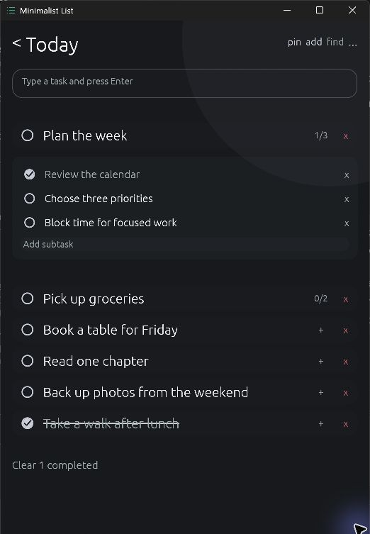

# Minimalist List

Minimalist List is a native desktop task list built with `egui` and `eframe`, inspired by MinimaList. It runs without an account or hosted service.

<p align="center">
  
  <br>
  <sub>Charcoal theme on Windows · Tasks and subtasks</sub>
</p>

## Install and run

Requires [Rust 1.95+](https://rustup.rs/), Visual Studio C++ build tools on Windows, and Xcode Command Line Tools on macOS (`xcode-select --install`). Ubuntu build dependencies:

```bash
sudo apt install \
  build-essential \
  pkg-config \
  libxkbcommon-dev \
  libwayland-dev \
  libx11-dev \
  libgl1-mesa-dev
```

Clone the repository and run the application:

```bash
git clone https://github.com/pszemraj/minimalist-list.git
cd minimalist-list
cargo run
```

For desktop installation and startup at sign-in, run the installer for your platform.

Windows (PowerShell):

```powershell
.\scripts\install-windows.ps1
```

Linux:

```bash
bash scripts/install-linux.sh
```

macOS:

```bash
bash scripts/install-macos.sh
```

Windows and Linux add an app-menu shortcut; macOS installs `~/Applications/Minimalist List.app`.

Sign-in starts the app hidden in the tray or menu bar; an ordinary launch opens the window. Close hides it again, as does minimize on Windows and Linux. Use the icon's **Show Minimalist List** or **Quit** action. Linux hiding requires X11/XWayland and a tray host; without one, the window opens normally.

The app stays out of the macOS Dock. Windows and X11 request no taskbar entry while the tray is available, including with the window open; without a tray they use a normal taskbar window. Linux desktop support varies, and native Wayland controls its own taskbar behavior.

Quit before reinstalling. See [startup and tray behavior](docs/usage.md#startup-and-system-tray) to disable startup.

Verify the checkout with `cargo test --locked`; `cargo run --locked -- --version` checks the executable. The [development guide](docs/dev.md#verification) lists the full checks.

## Start using it

Open a list and type `Buy groceries` into the field at the top. Enter adds the task at the top of the list and returns focus to the field. See [list management](docs/usage.md#manage-lists) to create more lists.

Press Backspace (`Delete` on macOS) when task entry is empty to return to Lists. Use arrows to choose a list and Enter to open it.

Press `Ctrl+/` (`Cmd+/` on macOS) to see the keyboard shortcuts in the app.

Show the running app from anywhere with `Ctrl+Alt+Shift+L` (`Cmd+Option+Shift+L` on macOS). Change or disable this in **Settings → Global shortcut**. Native Wayland sessions require a desktop launch binding; X11, macOS, and Windows use the registered shortcut.

## Documentation

- [Tasks, subtasks, search, history, and appearance](docs/usage.md)
- [Workspace folders, settings paths, and file sync](docs/storage.md)
- [Source layout, checks, and GUI inspection](docs/dev.md)

Bundled bold fonts: [sources](assets/fonts/SOURCES.txt), [Ubuntu Font Licence](assets/fonts/Ubuntu-LICENSE.txt), and [Hack licenses](assets/fonts/Hack-LICENSE.txt).
