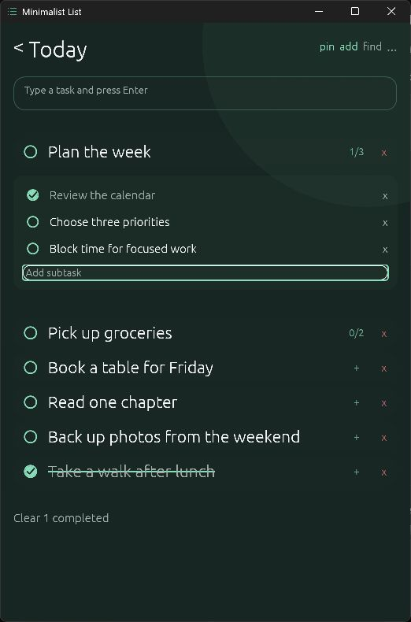

# Minimalist List

Minimalist List is a native desktop task list built with `egui` and `eframe`, inspired by MinimaList. It runs without an account or hosted service.



*Windows example with sample tasks and an expanded checklist.*

## Install and run

Install [Rust](https://rust-lang.org/tools/install/) 1.95 or newer on Linux, macOS, or Windows. On Windows, install the Visual Studio C++ build tools when prompted by the Rust installer. On Ubuntu, install the native windowing and OpenGL build dependencies:

```bash
sudo apt install \
  build-essential \
  pkg-config \
  libxkbcommon-dev \
  libwayland-dev \
  libx11-dev \
  libgl1-mesa-dev
```

Clone the repository and run the application:

```bash
git clone https://github.com/pszemraj/minimalist-list.git
cd minimalist-list
cargo run
```

If Rust is already installed through rustup, update it and build from the repository directory:

```bash
rustup update stable
rustc +stable --version
cargo +stable build --locked --release
```

Confirm that the reported version is at least 1.95. Cargo's [`rust-version`](https://doc.rust-lang.org/cargo/reference/rust-version.html) rejects older compilers; it does not upgrade them. The explicit [`+stable`](https://rust-lang.github.io/rustup/overrides.html#toolchain-override-shorthand) selects the updated toolchain even if an older directory override exists.

On macOS or Linux, if `rustup` is missing or `+stable` fails, check which installation supplies the commands:

```bash
command -v rustc cargo rustup
```

A separate installation, such as Homebrew's Rust, must be upgraded through its package manager, or replaced on `PATH` by the rustup installation.

Check the version without opening a window:

```bash
cargo run -- --version
```

Build and run an optimized binary with:

```bash
cargo build --release
./target/release/minimalist-list
```

On Windows, run `.\target\release\minimalist-list.exe` instead.

`Cargo.lock` is committed, so these commands use the dependency versions shipped with the application.

To install the binary for the current user:

```bash
cargo install --locked --path .
```

On Linux, install the desktop entry and checklist icon as well:

```bash
mkdir -p "${XDG_DATA_HOME:-$HOME/.local/share}/applications" \
  "${XDG_DATA_HOME:-$HOME/.local/share}/icons/hicolor/scalable/apps"
cp minimalist-list.desktop "${XDG_DATA_HOME:-$HOME/.local/share}/applications/"
cp assets/minimalist-list.svg "${XDG_DATA_HOME:-$HOME/.local/share}/icons/hicolor/scalable/apps/"
```

The desktop entry expects `minimalist-list` to be available on the desktop session's `PATH`.
The app and tray use the same checklist shape on Windows, macOS, and Linux;
macOS renders the tray icon using the menu bar's appearance. Linux Wayland
desktops use the installed desktop entry and icon for the app launcher and switcher.

## Start using it

Open a list and type `Buy groceries` into the field at the top. Enter adds the task at the top of the list and returns focus to the field. See [list management](docs/usage.md#manage-lists) to create more lists.

Press `Ctrl+/` (`Cmd+/` on macOS) to see the keyboard shortcuts in the app.

## Documentation

- [Tasks, subtasks, search, history, and appearance](docs/usage.md)
- [Workspace folders, settings paths, and file sync](docs/storage.md)
- [Source layout, checks, and GUI inspection](docs/dev.md)
