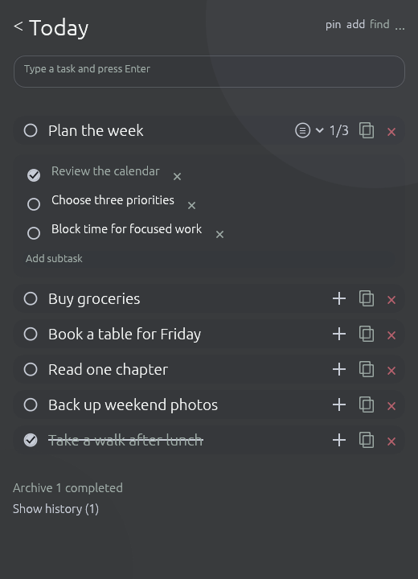

# Minimalist List

Minimalist List is a native desktop task list built with `egui` and `eframe`, inspired by MinimaList. It runs without an account or hosted service.

<p align="center">
  
  <br>
  <sub>Tasks and subtasks in the Charcoal theme on Windows</sub>
</p>

## Install and run

Requires [Rust 1.95+](https://rustup.rs/), Visual Studio C++ build tools on Windows, and Xcode Command Line Tools on macOS (`xcode-select --install`). Ubuntu build dependencies:

```bash
sudo apt install \
  build-essential \
  pkg-config \
  libxkbcommon-dev \
  libwayland-dev \
  libx11-dev \
  libgl1-mesa-dev
```

Clone the repository and run the application:

```bash
git clone https://github.com/pszemraj/minimalist-list.git
cd minimalist-list
cargo run
```

For desktop installation, run the installer for your platform.

Windows (PowerShell):

```powershell
.\scripts\install-windows.ps1
```

Linux:

```bash
bash scripts/install-linux.sh
```

macOS:

```bash
bash scripts/install-macos.sh
```

Windows and Linux add an app-menu shortcut. macOS installs `~/Applications/Minimalist List.app`. Quit before reinstalling. See [startup and system tray](docs/usage.md#startup-and-system-tray) for what the installers configure at sign-in.

Verify the checkout with `cargo test --locked`. Run `cargo run --locked -- --version` to check the executable. See the [development guide](docs/dev.md#verification) for the full checks.

## Start using it

Open a list, type `Buy groceries` into the [task entry](docs/usage.md#capture-and-edit-tasks), and press Enter. See [list management](docs/usage.md#manage-lists) to create more lists.

Use [keyboard navigation](docs/usage.md#keyboard-shortcuts) to work without a mouse, or the [global shortcuts](docs/usage.md#global-shortcuts) to show the running app or open Quick add from another application.

## Documentation

- [Tasks, subtasks, context, search, history, and appearance](docs/usage.md)
- [Workspace folders, settings paths, and file sync](docs/storage.md)
- [Source layout, checks, and GUI inspection](docs/dev.md)

See the bundled bold font [sources](assets/fonts/SOURCES.txt), the [Ubuntu Font Licence](assets/fonts/Ubuntu-LICENSE.txt), and the [Hack licenses](assets/fonts/Hack-LICENSE.txt).
