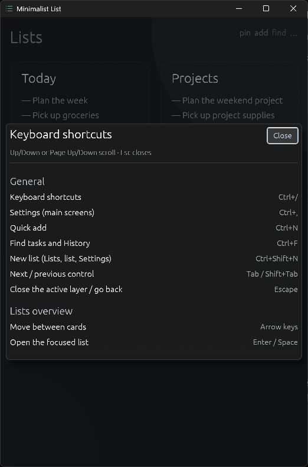
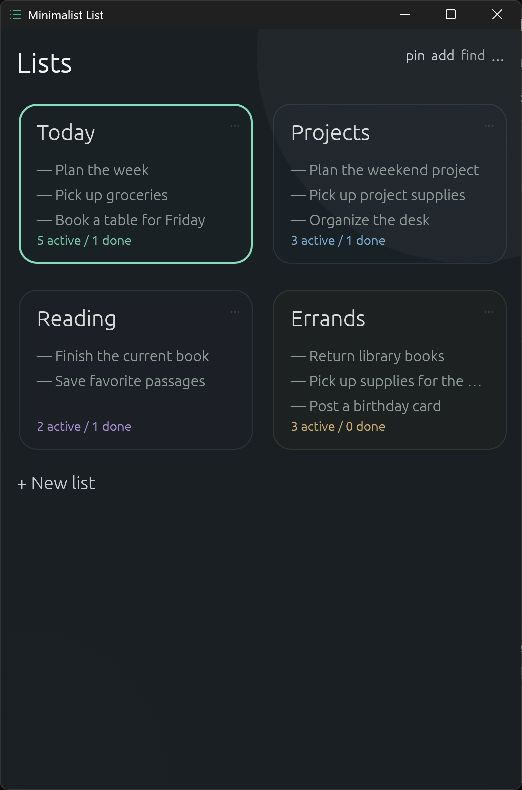
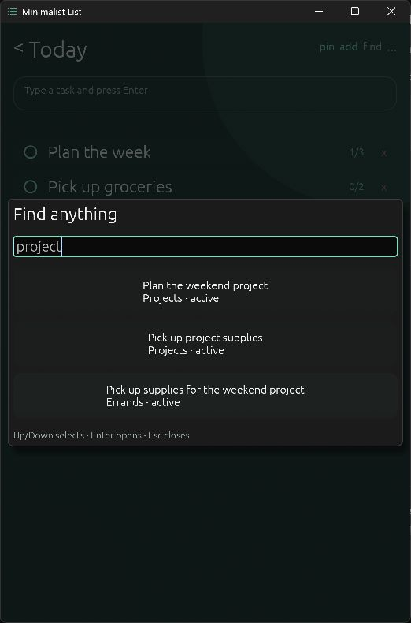

# Using Minimalist List

Shortcuts work while the application has keyboard focus. On macOS, use Command in place of Ctrl, except list switching uses Control on every platform. Home and End are Fn+Left and Fn+Right on MacBook keyboards.

Press `Ctrl+/` (`Cmd+/` on macOS) to show the in-app keyboard shortcut reference. Keyboard layouts that require Shift to type `/` are supported. Use Up/Down, Page Up/Page Down, or Home/End to scroll it. Escape or **Close** returns focus to the control you left. Quick add drafts and Find queries remain available underneath the reference.

## Manage lists

Press `Alt+Left` (`Cmd+[` on macOS) from a list to open the overview, with the card you left focused. Arrow keys move between list cards in the displayed grid; Enter or Space opens the focused list and puts the cursor in task entry. The back control and double-clicking a list title also open the overview. Backspace keeps its normal text-editing behavior.

`Ctrl+Shift+N` opens list creation from Lists, a list, or Settings. You can also select **+ New list**. Enter a name, optionally choose an accent, and press Enter to create it. Escape cancels.

Open a list card's settings to rename, recolor, or delete it. **Delete list** requires activating **Confirm delete list** a second time; at least one list must remain.

## Capture and edit tasks

Add tasks through the [list entry field](../README.md#start-using-it). Subtask entry stays focused after Enter so you can add several items in succession.

Down from task entry focuses the first task. Up and Down move between task rows; Home and End focus the first and last task. Up from the first task returns to entry. Enter on a task row edits its title; Enter saves and returns focus to that row, while Escape cancels the edit. Right opens subtasks and focuses their entry; Escape closes the panel and returns to its task. Left on a task row also collapses subtasks.

`Ctrl+N` opens Quick add from any screen. Choose a destination list and press Enter to save one task, or Escape to cancel. The selector remembers the last successful destination. The header's `add` action opens the same overlay.

Click task text to edit it inline. Enter or leaving the field saves; Escape cancels. The checklist and delete controls on the right become prominent on hover and remain keyboard-focusable. Use the checklist control to add and complete subtasks.

## Complete, reorder, and remove tasks

Use the circle on the left to complete or reactivate a task. It is keyboard-focusable, so Space or Enter also toggles it.

Space on a focused task row toggles completion. `Alt+Up` and `Alt+Down` move that task one position (Option on macOS), keeping it focused. Moving past the first or last position leaves the list file untouched. Forward Delete on a focused task row removes it (`Fn+Delete` on Mac keyboards). Delete, Space, and Enter on task rows act once per press; arrow navigation and reordering repeat while held. These row commands do not apply while editing text.

Drag a task vertically to reorder it. Drag right past the threshold to complete or reactivate it. Drag left to reveal Edit and Delete, then drag right to close those actions.

`Ctrl+Shift+Backspace` (`Shift+Cmd+Delete` on macOS) or **Clear completed** moves completed tasks into the list's restorable History section. With no completed tasks, it leaves the list file untouched. Deleting a task removes it instead of archiving it.

Select **Show history**, then **Restore** to return a task to the bottom of the list as incomplete, with its subtasks intact.

## Find and navigate

`Ctrl+F` or the header's `find` action searches task and subtask text across every list, including completed tasks and History. Use Up and Down to select a result, Enter to open it, and Escape to close the overlay. The selected task scrolls into view and is briefly highlighted.

`Ctrl+Tab` and `Ctrl+Shift+Tab` move between lists, including on macOS, where Command+Tab switches applications.

Tab and Shift+Tab reach individual controls, including list-card settings, task completion, subtasks, delete actions, History restoration, and Settings. Focused controls are outlined and scroll into view. Arrow keys inside text fields and Settings sliders retain their usual editing behavior.

Escape dismisses one layer per press: an open dropdown, the shortcut reference, Quick add or Find, Settings, an inline edit, list creation, subtasks, revealed task actions, or History. Holding it does not dismiss further layers. It leaves Lists and the task-list screen open. Closing an overlay restores its opening control; opening a search result focuses the matching task, subtask, or History restore action. Screen navigation saves an active inline task edit, like leaving its field.

## Window and appearance settings

`Ctrl+,` opens Settings from Lists or a list. Escape returns to the previous screen and restores focus. Applied preferences remain saved; leaving a list-name field applies its rename, including when `Ctrl+Shift+N` opens list creation. Closing Settings without editing the name preserves renames reloaded from disk. Typing a workspace path requires Enter or **Use typed path** to switch folders. Enter on an unchanged path preserves the current list and saved workspace selection.

The header's `pin` control toggles always-on-top mode. When native window decorations are disabled, drag the title to move the window and use the visible `x` control to close it.

Closing or minimizing the window saves any inline edit and hides it in the system tray. Open the tray icon's menu and choose **Show Minimalist List** to restore it or **Quit** to exit. Activating the icon also restores the window on desktops that support it. Shared-folder polling continues while hidden.

Linux uses X11 or XWayland for hiding and restoration when a desktop tray host is available, such as GNOME's AppIndicator extension or KDE's system tray. Without a usable tray, the app keeps the normal window backend and close/minimize behavior without a startup warning. Exiting saves inline edits and pending clear/delete actions.

Typography settings control proportional or monospace text, weight, size, and row spacing. Existing typography preferences are retained; reduce row spacing to fit more tasks on screen.

**Long titles** has two modes: **Scroll** (the default) keeps one line, uses an ellipsis at rest, and scrolls horizontally after a short hover delay; **Wrap** shows the full title across as many lines as needed. Scrolling stops when you leave the title, edit, or drag.

**Background opacity** starts at 85% and can be adjusted from 20% to 100%. It affects background surfaces while task text and controls stay readable, including in pinned mode. Desktop transparency depends on the operating system's compositor.

Choose folders and launch-time overrides through [workspace settings](storage.md#workspace-location). Appearance preferences save automatically at the [local settings path](storage.md#default-directories).
