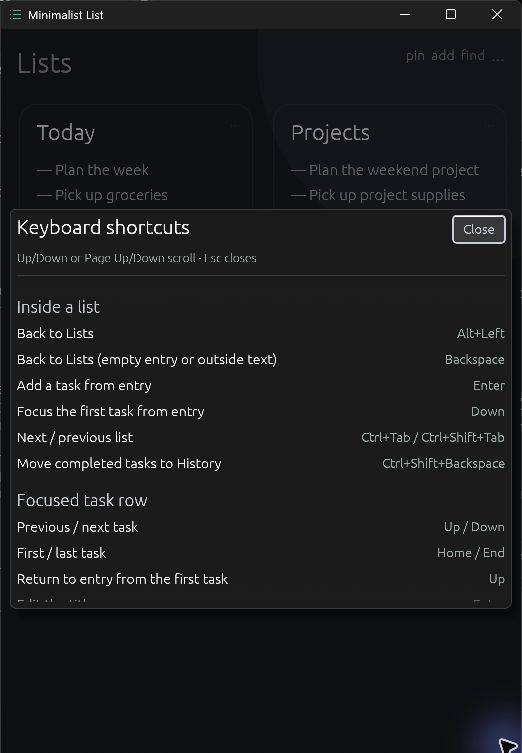
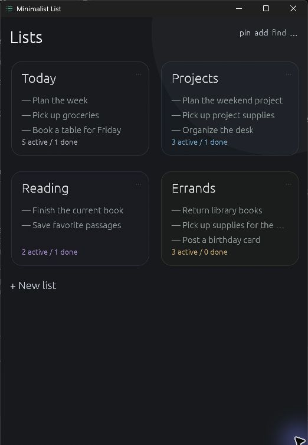
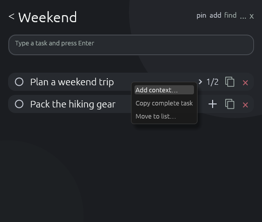
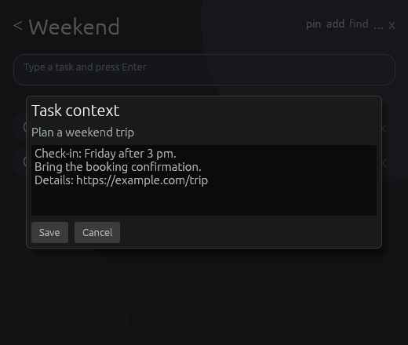
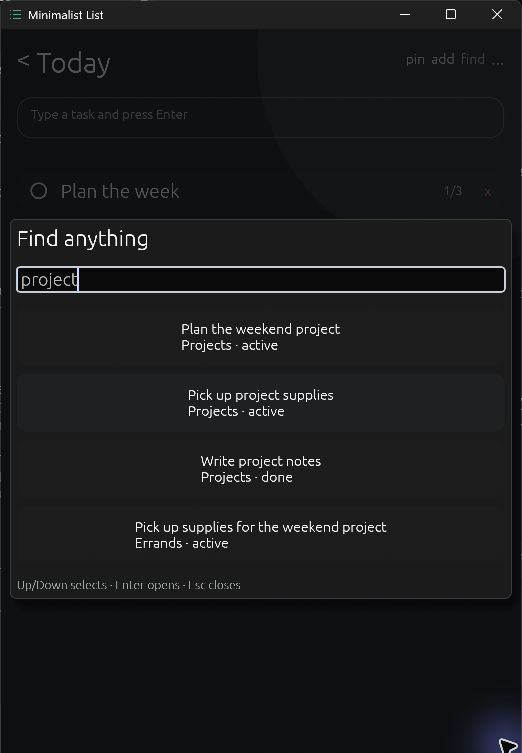

# Using Minimalist List

## Keyboard shortcuts

Application shortcuts require keyboard focus in the app. On macOS, use Command in place of Ctrl, except list switching uses Control on every platform. Home and End are Fn+Left and Fn+Right on MacBook keyboards; Page Up and Page Down are Fn+Up and Fn+Down.

Press `Ctrl+/` (`Cmd+/` on macOS) to show the in-app keyboard shortcut reference. Keyboard layouts that require Shift to type `/` are supported. Use Up/Down, Page Up/Page Down, or Home/End to scroll it. Escape or **Close** dismisses it. Quick add drafts and Find queries remain available underneath the reference.

## Manage lists

Press Backspace (`Delete` on macOS) from an empty task entry or a focused task row to open the overview, with the card you left focused. Backspace keeps deleting text while an entry or editor contains text, and holding it until the entry is empty does not navigate away. Close subtasks, History, or revealed row actions with Escape first. `Alt+Left` (`Cmd+[` on macOS), the back control, and double-clicking a list title also open the overview. Arrow keys move between list cards in the displayed grid; Enter or Space opens the focused list and puts the cursor in task entry.

`Ctrl+Shift+N` opens list creation from Lists, a list, or Settings. You can also select **+ New list**. New lists default to Charcoal, a muted grey palette. Enter a name, optionally choose an accent, and press Enter or select **Create list**. **Cancel** or Escape closes the form. Down from the name focuses the selected accent; Left/Right moves between colors. Enter or Space chooses the color and returns to the name; the next Enter creates the list. Up returns from colors to the name without selecting.

Open **List options** from a list header or card to rename, recolor, or delete that list. **Delete list** shows its name and affected task and History counts, then requires a separate **Confirm delete list** activation. **Cancel deletion** backs out; holding Enter or Space cannot confirm it. At least one list must remain. See [duplicate list files](storage.md#duplicate-list-files) if deletion is blocked by a conflicting identity.

In **Manual** order, drag overview tiles to rearrange them; the order is remembered separately for each workspace. **Sort lists** temporarily shows title, newest, or oldest order. Return to **Manual** to recover the arrangement.

## Capture and edit tasks

Type into the field above a list and press Enter to add a task. Task and subtask entry keep focus after Enter, including an empty submission. Unfinished task and checklist entries stay with their originating workspace and list or task during the session, including after navigation or closing a checklist.

Down from task entry focuses the first task. Up and Down move between task rows, including from their secondary controls; Home and End focus the first and last task. Up from the first task returns to entry.

Right opens a task's checklist and focuses its first child, or its add field when empty. Up/Down moves through children and the add field; Down from an expanded parent enters its checklist. Up from the first child returns to its parent. Home selects the first child and End reaches the add field when a child control is focused. Enter or Space on a child's completion control toggles it. Left outside text, or Escape, closes the checklist and returns to its parent. Moving through an open checklist preserves its unfinished entry; Left/Right/Home/End inside the entry keep editing text.

Enable **Settings → Appearance → Show subtasks below tasks** to preview every task's children. Each task's chevron collapses or expands its preview independently; **Edit subtasks** opens the full checklist editor. With this preference off, the checklist opens only when requested. Plus, copy, and delete controls are available beside each task.

`Ctrl+N` or the header's `add` action opens Quick add. A new capture prefers the open list, then the last successful available destination. Choose a list and press Enter or **Add**; a successful capture names its destination. Switching between Quick add and Find preserves their drafts. Nonempty captures keep their destination while it exists; choose another list if it was deleted. Empty drafts choose again when reopened. Escape cancels the capture.

Click task or child text to edit it inline, or press Enter on a focused task row. Tab also reaches child text, where Enter or Space starts editing. Enter or leaving the editor saves; Escape cancels. Saving a task title returns focus to its row; editing a child preserves its position and completion. Task editors save before navigating, archiving, hiding, or quitting. The checklist and delete controls on the right become prominent on hover and remain keyboard-focusable.

## Add task context

Use context for notes, links, booking details, or instructions while keeping the task title short. Context is multiline plain text and stays hidden in ordinary rows.

1. Right-click the task's title or row and choose **Add context…**. For a task with saved notes, the action is **Edit context…**.
2. Enter the details and choose **Save**. **Cancel** or Escape discards your changes; clicking outside the popup leaves it open. Hiding or quitting the app saves an open context draft.
3. To reopen saved notes, click the small circle with three horizontal lines beside the task's checklist control, or use **Edit context…** again. Clearing the text and saving removes the notes icon.

Saved context follows the task through Move, deletion Undo, and History, and syncs with its [list file](storage.md#file-sync-behavior). In History, right-click an archived task and choose **View context…** to read its notes without restoring it.

### Copy the complete task

Use a task's copy icon, its **Copy complete task** menu action, or `Ctrl+Shift+C` (`Cmd+Shift+C` on macOS) while any part of that task is focused. This copies the title, context, and complete checklist as plain text, with `[ ]` and `[x]` completion markers. It includes unsaved edits to the title, existing children, and context; submit a new child before copying to include it. Ordinary `Ctrl+C`/`Cmd+C` copies selected text. Successful copying shows an acknowledgement.

## Complete, reorder, and remove tasks

Use the circle on the left to complete or reactivate a task. It is keyboard-focusable, so Space or Enter also toggles it.

Space on a focused task row toggles completion. `Alt+Up` and `Alt+Down` move that task one position (Option on macOS), keeping it focused. Moving past the first or last position leaves the list file untouched. Forward Delete on a focused task row removes it (`Fn+Delete` on Mac keyboards). These row commands do not apply while editing text.

Drag a task vertically to reorder it. Drag right past the threshold to complete or reactivate it. Drag left to reveal Edit and Delete, then drag right to close those actions. Opening Quick add, Find, or the shortcut reference cancels an unfinished drag.

**List options → Sort** selects Manual, Title, Newest, Oldest, or Incomplete first. In Manual order, new tasks appear at the top. Return to Manual to recover your arrangement and use dragging or reorder shortcuts. See [stored order](storage.md#file-layout) for how sorting affects list files.

`Ctrl+Shift+Backspace` (`Shift+Cmd+Delete` on macOS) or **Archive completed** moves completed tasks into restorable History. With no completed tasks, it leaves the list file untouched.

Deleting a task or child shows **Undo**. Select it, or press `Ctrl+Z` (`Cmd+Z` on macOS) outside a text editor, to restore the latest deletion with its contents, completion, and original position. This recovery is available for the current workspace until another deletion, dismissal, or workspace switch; it is not saved across restarts. Whole-list deletion uses its separate confirmation.

Right-click a task to choose **Move to list**. Select a destination and **Move**; its identity, completion, checklist, and unfinished checklist draft follow it. A successful move names the destination.

Select **Show history** and activate an archived title to inspect its children without changing their state. **Restore** returns the parent as incomplete, with child completion unchanged. It appears at the bottom in Manual order; other sort modes determine its visible position.

Down from the last task reaches **Show history**, or Down from task entry when no tasks remain. Down, Right, or Enter on the History control opens it and focuses the first Restore action. Up/Down selects archived tasks; Enter or Space restores the focused task and focuses its active row. Up from the first archived task returns to the History control. Left or Escape closes History and returns to that control. Escape closes the focused History region first when a checklist is also open.

## Find and navigate

`Ctrl+F` or the header's `find` action searches task and subtask text across every list, including completed tasks and History. Use Up and Down to select a result, Enter to open it, and Escape to close the overlay. The selected task scrolls into view and is briefly highlighted. Opening an archived child reveals its read-only History contents. Results show each child's own completion state, with History labeled separately. Reopening Find retains the query and selection; ordinary wheel or trackpad scrolling keeps its position.

`Ctrl+Tab` and `Ctrl+Shift+Tab` move between lists, including on macOS, where Command+Tab switches applications. Each list remembers its own scroll position during the session.

Tab and Shift+Tab reach individual controls, including list-card settings, task completion, subtasks, delete actions, History restoration, and Settings. Focused controls are outlined and scroll into view. Left and Right retain their usual text-editing and slider-adjustment behavior.

Enter and Space activate controls once per press, including across focus changes and overlay dismissal; Delete on task rows follows the same rule. Typing spaces and holding editing, navigation, or reordering keys retain their normal repeat behavior.

Escape dismisses one layer per press: an open dropdown, the shortcut reference, Quick add or Find, Settings, an inline edit, list creation, subtasks, revealed task actions, or History. Holding it does not dismiss further layers. It leaves Lists and the task-list screen open. Closing an overlay restores its opening control; opening a search result focuses the matching task, subtask, or History restore action.

## Window and appearance settings

`Ctrl+,` opens global **Settings**, including layouts that require Shift to type a comma. The running application version appears beneath **App settings**. Workspace, window, and appearance preferences apply to every list. **Current list options** opens the selected list's [List options](#manage-lists); **App settings** returns to global preferences.

Applied preferences remain saved when leaving Settings. Leaving a list-name field, quitting, or switching workspaces applies its rename; an unchanged field preserves external renames.

In Settings, use Up/Down to move between rows and Left/Right to move within a row of choices. Enter or Space activates the focused control. Left/Right adjust a focused slider or move the cursor in a text field. Slider steps are 1 for text size and row spacing, and 1% for opacity. Page Up/Page Down jump between the current screen's sections, scrolling the focused control into view.

The header's `pin` control toggles always-on-top mode. Turn off **Show window title bar** to use the app's draggable title and visible `x` close control. Window size and position are saved for the next launch.

Typography settings control proportional or monospace text, real regular or bold faces, content size, and row spacing. Task titles, children, editors, History, and Find scale together. Reduce row spacing to fit more tasks on screen.

**Long titles** has two modes: **Scroll** (the default) keeps one line, uses an ellipsis at rest, and scrolls horizontally after a short hover delay; **Wrap** shows the full title across as many lines as needed. Scrolling stops when you leave the title, edit, or drag. Keyboard focus shows a truncated task title in a wrapped tooltip. In Wrap mode, hovering a card or task for two seconds shows its full title and basic information; context stays hidden.

**Background opacity** starts at 85% and can be adjusted from 20% to 100%. It affects background surfaces while task text and controls stay readable, including in pinned mode. Desktop transparency depends on the operating system's compositor.

Choose folders and launch-time overrides through [workspace settings](storage.md#workspace-location). Appearance preferences save automatically at the [local settings path](storage.md#default-directories).

For save errors and recovery, see [save recovery](storage.md#save-recovery).

## Startup and system tray

The sign-in entry created by the [installers](../README.md#install-and-run) passes `--start-hidden`; an ordinary launch opens the window. The flag can also be used with `--data-dir`. If a usable tray is unavailable at startup, the window opens so the app remains accessible.

`Ctrl+W` (`Cmd+W` on macOS) closes the window like its close button, including while an overlay is open. With a usable tray, closing the window saves inline edits and hides it in the system tray (the menu bar on macOS); minimizing does the same on Windows and Linux. Open the tray icon's menu and choose **Show Minimalist List** to restore it or **Quit** to exit. Activating the icon also restores the window on desktops that support it. Shared-folder polling continues while hidden. Launching the executable again for the same workspace and local settings asks the existing instance to show its window; duplicate `--start-hidden` launches stay quiet. Different workspaces can run separately.

With a usable tray, Windows keeps the app out of the taskbar even while its window is open. X11 requests the same behavior through the desktop's skip-taskbar hint; window managers may ignore it. If the tray is unavailable or disappears, Windows and X11 restore the taskbar entry. Native Wayland leaves taskbar placement to the compositor.

Linux uses X11 or XWayland for hiding and restoration when a desktop tray host is available, such as GNOME's AppIndicator extension or KDE's system tray. Without a usable tray, the app keeps the normal window backend and close/minimize behavior without a startup warning. If the tray host disappears while hidden, the window returns. Exiting saves accepted archive/delete actions; [save failures](storage.md#save-recovery) keep the window available for recovery.

On X11, cursor theme and size follow the desktop's XSettings, including its display scale. Explicit `XCURSOR_THEME` and `XCURSOR_SIZE` overrides take precedence. Restart the app after changing these desktop settings; native Wayland uses its existing cursor backend.

On macOS, reopening the running app bundle through Finder or `open` restores its existing window. The app uses the menu bar without a Dock icon, including while its window is open. The minimize button is disabled to avoid leaving a hidden window in the Dock. Hidden startup avoids requesting activation over another app. **Quit** exits for the remainder of the session; the launch agent does not keep restarting it.

To disable startup on Windows, remove **Minimalist List** from the Startup folder (`shell:startup` in Run). On Linux, remove `${XDG_CONFIG_HOME:-$HOME/.config}/autostart/minimalist-list.desktop`. On macOS, quit the app and remove `~/Library/LaunchAgents/io.github.pszemraj.minimalist-list.plist`. Reinstalling enables startup again.

### Global reveal shortcut

The global reveal shortcut works while another application has focus: `Ctrl+Alt+Shift+L`, or `Cmd+Option+Shift+L` on macOS. It shows the existing window and keeps it visible on repeated presses. Change or disable it in **Settings → Global shortcut**; registration conflicts are reported without replacing the previous shortcut. The app must be running. Native Wayland requires a desktop shortcut that launches the app; its built-in registration uses X11.
