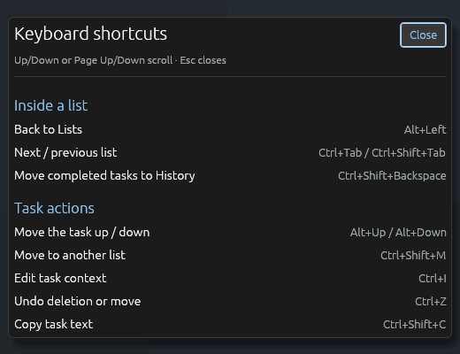
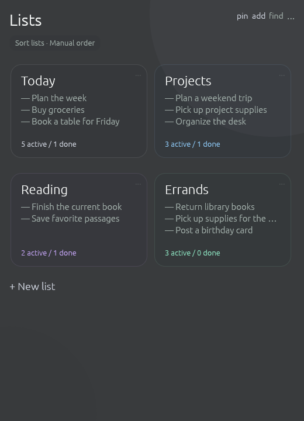
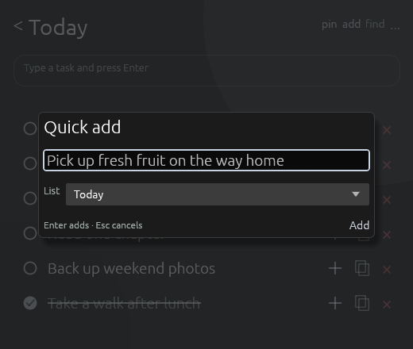
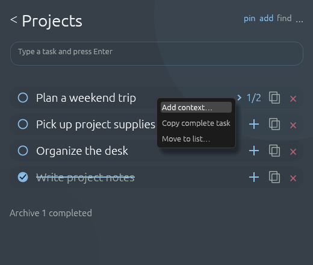
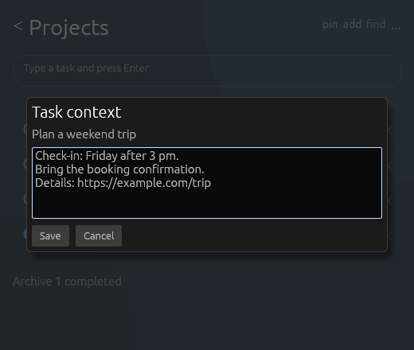
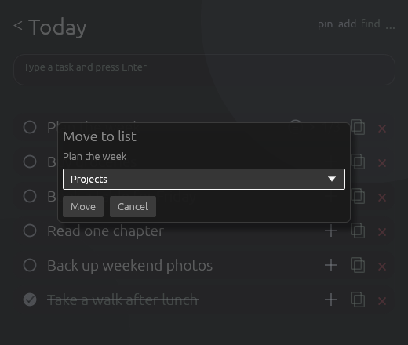
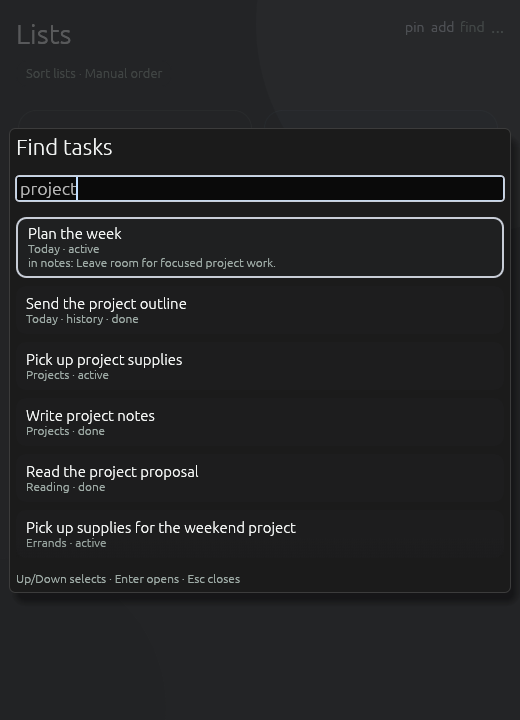

# Using Minimalist List

## Keyboard shortcuts

Application shortcuts require keyboard focus in the app. On macOS, use Command for Ctrl except when [switching lists](#find-and-navigate), and Option for Alt. Backspace is labeled Delete. Home and End are Fn+Left and Fn+Right on MacBook keyboards. Page Up and Page Down are Fn+Up and Fn+Down.

Press `Ctrl+/` to show the in-app keyboard shortcut reference. Keyboard layouts that require Shift to type `/` are supported. Use Up/Down, Page Up/Page Down, or Home/End to scroll it. Escape or **Close** dismisses it.

## Manage lists

Press Backspace from an empty task entry or a focused task row to open the overview, with the card you left focused. Backspace keeps deleting text while an entry or editor contains text, and holding it until the entry is empty does not navigate away. Close subtasks, History, or revealed row actions with Escape first. `Alt+Left` (`Cmd+[` on macOS), the back control, and double-clicking a list title also open the overview. Arrow keys move between list cards in the displayed grid; Enter or Space opens the focused list and puts the cursor in task entry.

`Ctrl+Shift+N` opens list creation from Lists, a list, or Settings. You can also select **+ New list**. New lists default to Charcoal, a muted grey palette. Enter a name, optionally choose an accent, and press Enter or select **Create list**. **Cancel** or Escape closes the form. Down from the name focuses the selected accent; Left/Right moves between colors. Enter or Space chooses the color and returns to the name; the next Enter creates the list. Up returns from colors to the name without selecting.

Open **List options** from a list header or card to rename, recolor, or remove the list or its History.

- **Clear History** appears when the list has archived tasks. Review the count, then choose **Confirm clear History** or **Cancel**. Recover cleared entries from a [local snapshot](storage.md#local-backups).
- **Delete list** shows the list name and counts for active and archived tasks. Choose **Confirm delete list** or **Cancel deletion**. At least one list must remain. See [local backups](storage.md#local-backups) to recover a deleted list and [duplicate list files](storage.md#duplicate-list-files) if deletion is blocked.

Each confirmation requires a separate press. Holding Enter or Space cannot confirm it.

In **Manual** order, drag overview tiles to rearrange them. **Sort lists** temporarily shows title, newest, or oldest order. Return to **Manual** to recover the arrangement.

## Capture and edit tasks

Type into the field above a list and press Enter to add a task. Task and subtask entry keep focus after Enter, including an empty submission. Unfinished entries stay with their originating workspace and list or task during navigation and after closing a checklist. They last until the app quits.

Paste a list into task entry, a checklist's add field, or [Quick add](#quick-add) to create one incomplete item per line. The app trims whitespace, strips leading bullets, numbers, and Markdown checkboxes, and skips blank items. A paste with fewer than two items goes into the field as ordinary text. A batch leaves separately typed text in the field. In Quick add a successful batch goes to the selected list and closes the overlay if the field was empty.

Down from task entry focuses the first task. Up and Down move between task rows, including from their secondary controls; Home and End focus the first and last task. Up from the first task returns to entry.

Right opens a task's checklist and focuses its first child, or its add field when empty. Up/Down moves through children and the add field; Down from an expanded parent enters its checklist. Up from the first child returns to its parent. Home selects the first child and End reaches the add field when a child control is focused. Enter or Space on a child's completion control toggles it. Left outside text, or Escape, closes the checklist and returns to its parent. Left/Right/Home/End inside the entry keep editing text.

Enable **Settings -> Appearance -> Show subtasks below tasks** to preview every task's children. Each task's chevron collapses or expands its preview independently; **Edit subtasks** opens the full checklist editor. With this preference off, the checklist opens only when requested.

Click task or child text to edit it inline, or press Enter on a focused task row. Tab also reaches child text, where Enter or Space starts editing. Enter or leaving the editor saves; Escape cancels. Enter returns focus to the task row or child's completion control; clicking another field keeps focus there. Editing a child preserves its position and completion. The checklist and delete controls on the right become prominent on hover and remain keyboard-focusable.

### Quick add

Press `Ctrl+N` or select the header's `add` action. Quick add defaults to the open list. From outside a list, it tries the last successful capture destination, the last opened list, then the first available list. Choose a destination and press Enter or **Add**. The success message names the destination.

Switching between Quick add and Find preserves their drafts. A nonempty capture keeps its destination until you change it or that list disappears. If the list disappears, choose another to save. An empty draft chooses a destination again when reopened. Escape cancels the capture. See [save recovery](storage.md#save-recovery) if a capture fails.

You can also open Quick add from the [tray](#startup-and-system-tray) or with its [global shortcut](#global-shortcuts).

## Add task context

Use context for notes, links, booking details, or instructions while keeping the task title short. Context is multiline plain text and stays hidden in ordinary rows.

1. Right-click the task's title or row and choose **Add context...**. For a task with saved notes, the action is **Edit context...**. From the keyboard, press `Ctrl+I` with focus on a task row, one of its controls, a checklist item, or its title editor; typed edits are saved first and the notes field opens focused.
2. Enter the details and choose **Save**. **Cancel** or Escape discards your changes; clicking outside the popup leaves it open. See [save recovery](storage.md#save-recovery) for hiding or quitting with a draft.
3. To reopen saved notes, click the small circle with three horizontal lines beside the task's checklist control, or use **Edit context...** again. Clearing the text and saving removes the notes icon.

Saved context follows the task through Move, deletion Undo, and History, and syncs with its [list file](storage.md#file-sync-behavior). In History, right-click an archived task and choose **View context...**, or press `Ctrl+I` on its focused row, to read its notes without restoring it.

### Copy the complete task

Use **Copy complete task** in the task menu or press `Ctrl+Shift+C` while any part of that task is focused. Wider rows also show a copy icon; narrow rows leave that space for the title. This copies the title, context, and complete checklist as plain text, with `[ ]` and `[x]` completion markers. It includes unsaved edits to the title, existing children, and context; submit a new child before copying to include it. Ordinary `Ctrl+C` copies selected text. Successful copying shows an acknowledgement.

## Complete, reorder, and remove tasks

Use the circle on the left to complete or reactivate a task. With the circle focused, press Space or Enter. With the row focused, press Space.

On a focused row, `Alt+Up` and `Alt+Down` move the task one position and keep it focused. Moving past the first or last position leaves the list file untouched. Forward Delete removes the task (`Fn+Delete` on Mac keyboards). These row commands apply outside text editors.

Drag a task vertically to reorder it. Drag right past the threshold to complete or reactivate it. Drag left to reveal Edit and Delete, then drag right to close those actions. Opening Quick add, Find, or the shortcut reference cancels an unfinished drag.

**List options -> Sort** selects Manual, Title, Newest, Oldest, or Incomplete first. In Manual order, new tasks appear at the top. Return to Manual to recover your arrangement and use dragging or reorder shortcuts. See [stored order](storage.md#file-layout) for how sorting affects list files.

`Ctrl+Shift+Backspace` or **Archive N completed** moves the displayed count of completed tasks into restorable History. The shortcut works from an empty task or subtask entry; nonempty fields and inline editors keep editing text. With no completed tasks, it leaves the list file untouched.

Deleting a task, child, or History entry, or moving a task, shows **Undo**. Select it or press `Ctrl+Z` outside a text editor. Undo restores a deleted item with its contents, completion, and original position, including the archive time for a History entry. Undo returns a moved task to its original position in its source list.

Undo applies to the latest deletion or move and lasts until the next deletion or move, dismissal, workspace switch, or restart. If a moved task or either list is gone, or the original list already holds the task, Undo explains why and stays available.

Right-click a task and choose **Move to list**, or press `Ctrl+Shift+M` with focus on a task row, one of its controls, a checklist item, or its title editor. The app saves inline edits first. The picker starts on the last destination used this session if it is still available, or the first other list. Use Up and Down to change the destination, Enter or **Move** to confirm, and Escape to return to the task. If the destination disappears while the picker is open, choose another.

A moved task keeps its identity, completion, context, checklist, and unfinished checklist draft. It appears at the top in Manual order. Focus moves to the neighboring row, and the notice names the destination and offers **Undo**. See [save recovery](storage.md#save-recovery) for what happens if either write fails.

Select **Show history** and activate an archived title to inspect its children without changing their state. Each archived task shows a muted "Archived 3 days ago" line under its title. **Restore** returns the parent as incomplete, with child completion unchanged. It appears at the bottom in Manual order; other sort modes determine its visible position.

Right-click an archived task and choose **Delete permanently**, or press forward Delete (`Fn+Delete` on Mac keyboards) while its title or **Restore** is focused, to remove just that task; holding the key removes one task per press. The notice offers **Undo**, and focus moves to the neighbouring archived task. To empty a whole History, use **Clear History** in [List options](#manage-lists).

Down from the last task reaches **Show history**, or Down from task entry when no tasks remain. Down, Right, or Enter on the History control opens it and focuses the first Restore action. Up/Down selects archived tasks; Enter or Space restores the focused task and focuses its active row. Up from the first archived task returns to the History control. Left or Escape closes History and returns to that control. Escape closes the focused History region first when a checklist is also open.

## Find and navigate

`Ctrl+F` or the header's `find` action searches task titles, notes (context), and subtasks across every list, including completed tasks and History. Search ignores case. All words must match the same result. A task can match across its title and notes, and the result shows a snippet when a word matches only in the notes.

Use Up and Down to select a result, Enter to open it, and Escape to close Find. The selected task scrolls into view and is briefly highlighted. Opening an archived child reveals its read-only History contents. Results show each child's own completion state, with History labeled separately. Reopening Find retains the query and selection. Scrolling the results with a wheel or trackpad keeps the selection.

`Ctrl+Tab` and `Ctrl+Shift+Tab` move between lists, including on macOS, where Command+Tab switches applications. Each list remembers its own scroll position during the session.

Tab and Shift+Tab reach individual controls, including list-card settings, task completion, subtasks, delete actions, History restoration, and Settings. Focused controls are outlined and scroll into view. Left and Right retain their usual text-editing and slider-adjustment behavior.

Enter and Space activate controls once per press, including across focus changes and overlay dismissal; Delete on task rows follows the same rule. Typing spaces and holding editing, navigation, or reordering keys retain their normal repeat behavior.

Escape dismisses one layer per press: an open dropdown, the shortcut reference, Quick add or Find, Settings, an inline edit, list creation, subtasks, revealed task actions, or History. Holding it does not dismiss further layers. It leaves Lists and the task-list screen open. Closing an overlay restores its opening control; opening a search result focuses the matching task, subtask, or History restore action.

## Window and appearance settings

`Ctrl+,` opens global **Settings**, including layouts that require Shift to type a comma. The running application version appears beneath **App settings**. Workspace, window, and appearance preferences apply to every list. **Current list options** opens the selected list's [List options](#manage-lists); **App settings** returns to global preferences.

Leaving a list-name field applies its rename; an unchanged field preserves external renames. See [save recovery](storage.md#save-recovery) for pending edits when leaving the application.

In Settings, use Up/Down to move between rows and Left/Right to move within a row of choices. Enter or Space activates the focused control. Left/Right adjust a focused slider or move the cursor in a text field. Slider steps are 1 for text size and row spacing, and 1% for opacity. Page Up/Page Down jump between the current screen's sections, scrolling the focused control into view.

The header's `pin` control toggles always-on-top mode. Turn off **Show window title bar** to use the app's draggable title and visible `x` close control. Window size and position are saved for the next launch.

Typography settings control proportional or monospace text, real regular or bold faces, content size, and row spacing. Task titles, children, editors, History, and Find scale together. Reduce row spacing to fit more tasks on screen.

For active task titles, **Long titles** has two modes: **Scroll** (the default) keeps one line, uses an ellipsis at rest, and scrolls horizontally after a short hover delay; **Wrap** shows the full title across as many lines as needed. Scrolling stops at the end, or when you leave the title, edit, or drag. Leave and reenter the title to scroll again.

Keyboard focus shows a truncated task title in a wrapped tooltip. In Wrap mode, hovering a card or task for two seconds shows its full title and basic information; context stays hidden.

**Background opacity** starts at 85% and can be adjusted from 20% to 100%. It affects background surfaces, including in pinned mode, while task text and controls stay fully opaque. Low opacity reduces text contrast over bright backgrounds. Desktop transparency depends on the operating system's compositor.

Choose folders and launch-time overrides through [workspace settings](storage.md#workspace-location). See [local settings paths](storage.md#default-directories) for preferences.

## Startup and system tray

The [installers](../README.md#install-and-run) add a sign-in entry with `--start-hidden`. An ordinary launch opens the window, as does a hidden launch without a usable tray. See [workspace overrides](storage.md#workspace-location) to select a folder at launch.

`Ctrl+W` closes the window like its close button, including while an overlay is open. With a usable tray, closing hides the window in the tray (the menu bar on macOS). Minimizing does the same on Windows and Linux. On desktops such as GNOME that disable minimize for windows hidden from the taskbar, use close or `Ctrl+W`.

From the tray icon's menu, choose **Show Minimalist List** to restore the window, **Quick add** to open it with the capture field focused, or **Quit** to exit. Activating the icon also restores the window on desktops that support it. [Workspace scans](storage.md#file-sync-behavior) continue while hidden. See [save recovery](storage.md#save-recovery) for pending edits.

Launching again with the same workspace and local settings shows the existing window. A duplicate `--start-hidden` launch leaves its visibility alone. Different workspaces can run separately.

With a usable tray, Windows keeps the app out of the taskbar even while its window is open. X11 requests the same behavior through the desktop's skip-taskbar hint; window managers may ignore it. If the tray is unavailable or disappears, Windows and X11 restore the taskbar entry. Native Wayland leaves taskbar placement to the compositor.

Linux uses X11 or XWayland for hiding and restoration when a desktop tray host is available, such as GNOME's AppIndicator extension or KDE's system tray. Without a usable tray, the app keeps the normal window backend and close/minimize behavior without a startup warning. If the tray host disappears while hidden, the window returns. Temporary tray-query timeouts keep an established tray's hiding behavior.

On X11, cursor theme and size follow the desktop's XSettings. The advertised cursor size already includes the desktop scale and is used directly. Explicit `XCURSOR_THEME` and `XCURSOR_SIZE` overrides take precedence. Restart the app after changing these desktop settings; native Wayland uses its existing cursor backend.

On macOS, reopening the running app bundle through Finder or `open` restores its existing window. The app uses the menu bar without a Dock icon, including while its window is open. The minimize button is disabled to avoid leaving a hidden window in the Dock. Hidden startup avoids requesting activation over another app. **Quit** exits for the remainder of the session; the launch agent does not keep restarting it.

To disable startup on Windows, remove **Minimalist List** from the Startup folder (`shell:startup` in Run). On Linux, remove `${XDG_CONFIG_HOME:-$HOME/.config}/autostart/minimalist-list.desktop`. On macOS, quit the app and remove `~/Library/LaunchAgents/io.github.pszemraj.minimalist-list.plist`. Reinstalling enables startup again.

### Global shortcuts

While the app is running, `Ctrl+Alt+Shift+L` shows its window and keeps it visible on repeated presses. `Ctrl+Alt+Shift+N` shows the window and opens [Quick add](#quick-add) with its text field focused. On macOS, use Command and Option for these defaults. The Quick add shortcut dismisses the shortcut reference, the Move dialog, and open menus. If Quick add is already open, the shortcut focuses the existing draft.

In **Settings -> Global shortcut** or **Settings -> Quick add shortcut**, type a chord and choose **Apply shortcut**, or choose **Disable shortcut**. Use Ctrl or Command with another modifier and a letter, number, Space, or function key. Each action needs its own chord. If registration fails, the previous shortcut remains active.

On Linux, built-in global shortcuts use X11. Without an X11 display, bind the app launcher in your desktop settings to open or reveal the window.
